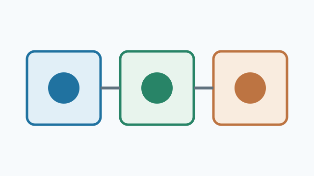
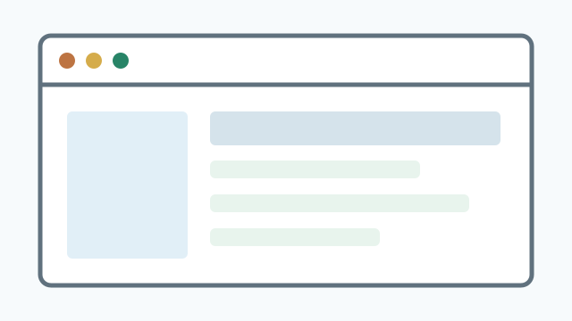
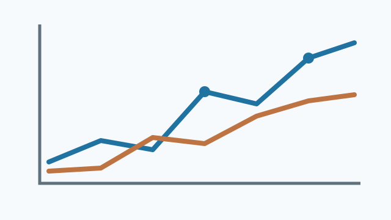

## 1. Colonnes, cartes et images {nav-title="Colonnes"}

::::: {.columns}

::: {.column width="48%"}
::: {.callout-note}
### Un document, deux rendus

Le **texte reste modifiable** dans PowerPoint. L’image garde son cadrage.
:::

{width="43%"}
:::

::: {.column width="48%"}
::: {.callout-tip}
### Mesures contrôlées

- Dimensions des boîtes
- Position des puces
- Alignement vertical
:::

{width="43%"}
:::

:::::

## 2. Tableau et SVG {nav-title="Tableau SVG"}

::: {.callout-important}
Le tableau, ses chiffres et sa légende doivent rester lisibles et éditables.
:::

::::: {.columns}
::: {.column width="53%"}
| Étape | Durée | Sortie |
|:--|--:|:--|
| Capture DOM | 2 s | Géométrie |
| Conversion | 4 s | Objets PPTX |
| Contrôle | 1 s | Rapport |

: Exemple de tableau Quarto {#tbl-pptx-test}
:::
::: {.column width="43%"}
{width="92%"}
:::
:::::

## 3. Parcours et flèches {nav-title="Flèches"}

::: {.flow-test}
::: {.flow-step}
**Source Quarto**

Un seul fichier `.qmd`
:::
::: {.flow-step}
**Mise en page RevealJS**

CSS calculé dans Chromium
:::
::: {.flow-step}
**PowerPoint**

Textes et formes modifiables
:::
:::

::: {.callout-warning}
Les flèches générées en CSS doivent rester alignées avec les boîtes.
:::

{width="30%"}

## 4. Une diapositive à défilement {.scrollable nav-title="Défilement"}

Chaque bloc ci-dessous doit apparaître sur une diapositive PPTX, sans être coupé.

::: {.callout-note}
### Première section

La conversion préserve l’ordre des éléments et le titre sur les pages de suite.
:::

{width="44%"}

::: {.callout-tip}
### Deuxième section

Cette boîte contient plusieurs lignes de texte et une deuxième partie de la page défilante.
:::

| Variable | Observation | Contrôle |
|:--|:--|:--|
| A | Première série | Présent |
| B | Deuxième série | Présent |
| C | Troisième série | Présent |

::: {.callout-important}
### Troisième section

Ce dernier bloc doit rester visible dans le PPTX même s’il est sous le pli de la vue RevealJS.
:::

## 5. Onglets Quarto {nav-title="Onglets"}

Chaque onglet devient une diapositive PPTX distincte.

::: {.panel-tabset}

### Synthèse

::: {.callout-note}
Un premier panneau avec sa **propre image** et du texte modifiable.
:::

{width="45%"}

### Références

::: {.callout-tip}
Le deuxième panneau présente une autre disposition et une autre image.
:::

{width="45%"}

### Outils

::: {.callout-warning}
Le troisième panneau vérifie que l’ordre des onglets est conservé.
:::

{width="45%"}

:::
