## Fichiers R et QMD {nav-title="FICHIERS"}

::: {.layout}
::: {.copy}
```text
scripts/import.R       import et préparation
scripts/analyses.R     calculs réutilisés
analyse.qmd            analyse et résultats
article.qmd            manuscrit
supplements.qmd        méthodes et figures détaillées
references.bib         références
```

Un petit projet peut commencer avec **un seul QMD**. Séparer les scripts R et les QMD quand le contenu devient long ou sert à plusieurs documents.

<div class="links">
<a href="https://quarto.org/docs/projects/quarto-projects.html" target="_blank">Projets Quarto</a>
<a href="https://github.com/thomashusson29/These_Brieuc" target="_blank">Exemple de projet</a>
</div>
:::
::: {.visual}
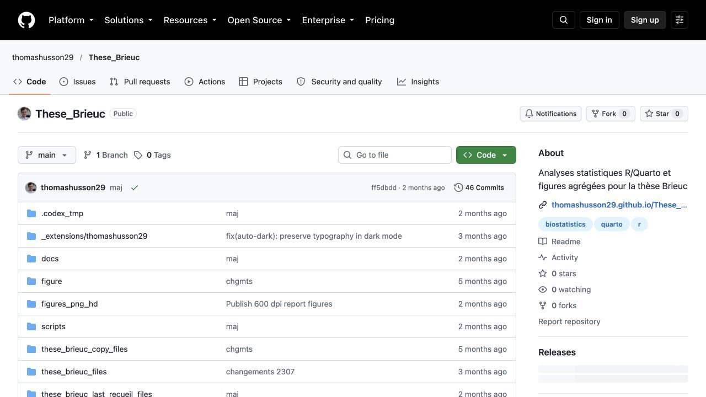{.shot}

<small>[Capture : projet These_Brieuc](https://github.com/thomashusson29/These_Brieuc)</small>
:::
:::

## Demander une modification à Codex ou Claude Code {nav-title="ASSISTANTS"}

::: {.copy-wide}
Donner le **dossier du projet**, les fichiers concernés, le résultat attendu et la commande de rendu.

> « Lis `analyse.qmd` et les scripts R appelés. Ajoute le tableau demandé avec un paquet existant. Donne la documentation des fonctions utilisées. Modifie les fichiers nécessaires, lance `quarto render`, puis indique les avertissements et le diff. »
:::

::: {.two-visuals}
::: {.visual}
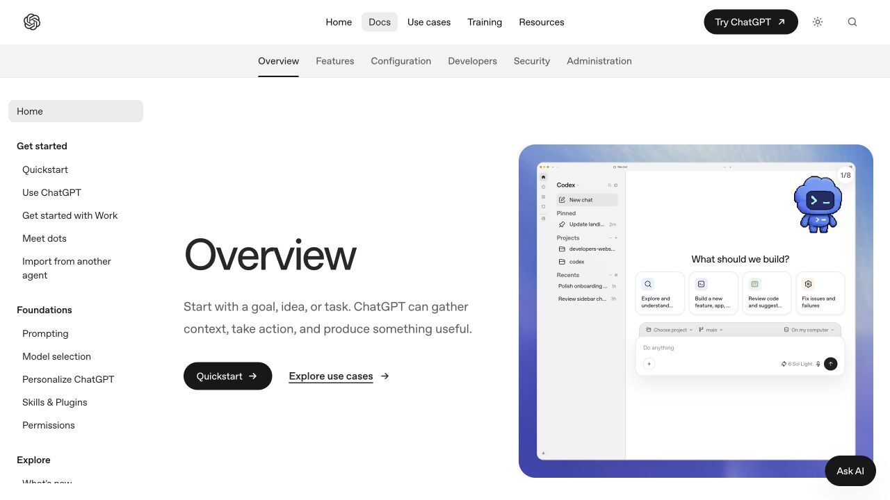{.shot .small-shot}
<small>[Codex : prise en main](https://openai.com/academy/codex/)</small>
:::
::: {.visual}
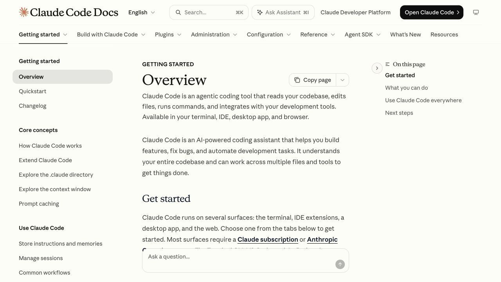{.shot .small-shot}
<small>[Claude Code : démarrage](https://code.claude.com/docs/en/quickstart)</small>
:::
:::

## Dans les prompts : paquets et documentation {nav-title="PAQUETS R"}

::: {.layout}
::: {.copy}
> « Utilise une fonction d'un paquet R maintenu plutôt qu'une fonction maison. Donne le lien de sa documentation, les arguments choisis et un exemple adapté à mes données. »

**Selon le besoin :** `dplyr`, `gtsummary`, `mice`, `WeightIt`, `cobalt`, `survival`… Charger uniquement les paquets utilisés.

<div class="links">
<a href="https://dplyr.tidyverse.org/articles/dplyr.html" target="_blank">dplyr</a>
<a href="https://www.danieldsjoberg.com/gtsummary/articles/tbl_summary.html" target="_blank">gtsummary</a>
<a href="https://amices.org/mice/reference/mice.html" target="_blank">mice</a>
<a href="https://ngreifer.github.io/cobalt/articles/cobalt.html" target="_blank">cobalt</a>
</div>
:::
::: {.visual}
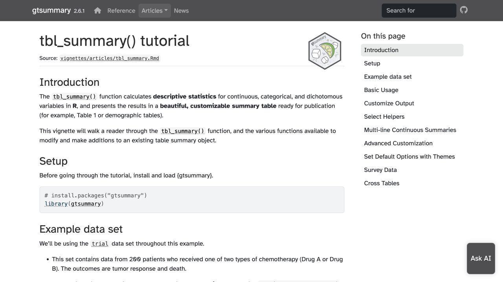{.shot}

<small>[Capture : `gtsummary::tbl_summary()`](https://www.danieldsjoberg.com/gtsummary/articles/tbl_summary.html)</small>
:::
:::

## Relire une modification proposée {nav-title="VÉRIFIER"}

::: {.layout}
::: {.copy}
```bash
git diff
quarto render analyse.qmd --to html
```

Dans le prompt : **« Compare le code exécuté aux méthodes écrites, tableaux et figures. Signale les écarts. »**

Relire les changements R, les avertissements du rendu et les résultats modifiés avant le commit.

<div class="links">
<a href="https://docs.github.com/en/get-started/using-git/about-git" target="_blank">Git et diff</a>
<a href="https://quarto.org/docs/computations/r.html" target="_blank">Exécution R dans Quarto</a>
</div>
:::
::: {.visual}
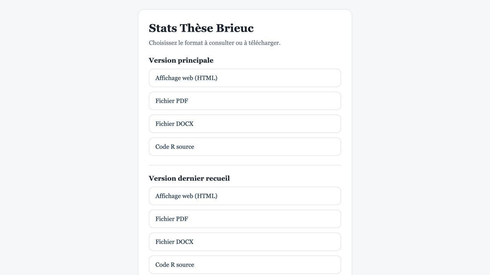{.shot}

<small>[Capture : rapport à relire après rendu](https://thomashusson29.github.io/These_Brieuc/)</small>
:::
:::

## Un QMD, ou plusieurs selon les documents {nav-title="QUARTO"}

::: {.layout}
::: {.copy}
```bash
quarto render analyse.qmd --to html
quarto render article.qmd --to docx
quarto render supplements.qmd --to html
```

Le QMD contient texte, blocs R, tableaux, figures et citations. Les scripts R peuvent porter les calculs utilisés dans plusieurs documents.

**Exemple :** le projet Hartmann sépare manuscrit et suppléments.

<div class="links">
<a href="https://quarto.org/docs/get-started/computations/rstudio" target="_blank">Tutoriel Quarto + R</a>
<a href="https://quarto.org/docs/output-formats/ms-word.html" target="_blank">Rendu Word</a>
</div>
:::
::: {.visual}
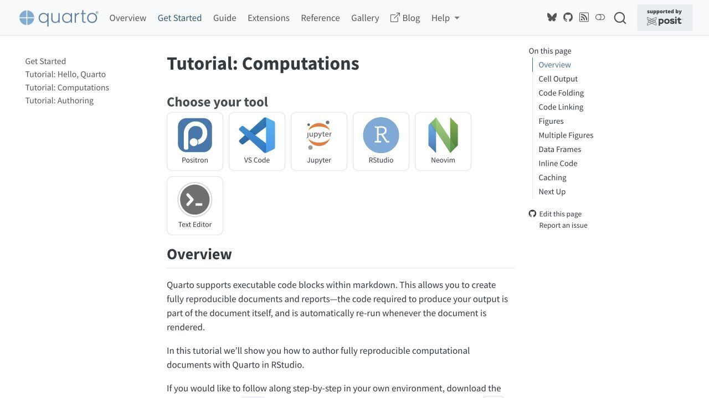{.shot}

<small>[Capture : tutoriel Quarto](https://quarto.org/docs/get-started/computations/rstudio)</small>
:::
:::

## Article et suppléments {nav-title="DOCUMENTS"}

::: {.layout}
::: {.copy}
- Réutiliser les résultats calculés dans l'analyse.
- Préparer à part méthodes détaillées, diagnostics et analyses de sensibilité.
- Après une révision, mettre à jour code, tableaux, figures, manuscrit et réponse aux reviewers.

**Dans les projets examinés :** suppléments avec diagnostics d'imputation, équilibre des covariables et analyses de sensibilité.

<div class="links">
<a href="https://quarto.org/docs/authoring/figures-and-layout.html" target="_blank">Figures Quarto</a>
<a href="https://quarto.org/docs/authoring/cross-references.html" target="_blank">Renvois tableaux/figures</a>
</div>
:::
::: {.visual}
{.shot}

<small>[Figure issue d'un rapport Quarto public](https://thomashusson29.github.io/These_Brieuc/these_brieuc.html)</small>
:::
:::

## Zotero et citations Quarto {nav-title="RÉFÉRENCES"}

::: {.layout}
::: {.copy}
```yaml
bibliography: references.bib
csl: style-vancouver.csl
```

Dans le texte : `[@cle_bibliographique]`. Vérifier la source citée et ce qu'elle permet d'affirmer.

Figures et tableaux ont des identifiants ; le texte y renvoie avec `@fig-...` et `@tbl-...`.

<div class="links">
<a href="https://quarto.org/docs/authoring/footnotes-and-citations" target="_blank">Citations Quarto</a>
<a href="https://quarto.org/docs/authoring/cross-references.html" target="_blank">Références croisées</a>
<a href="https://www.zotero.org/support/" target="_blank">Documentation Zotero</a>
</div>
:::
::: {.visual}
{.shot}

<small>[Capture : document scientifique publié](https://thomashusson29.github.io/These_Brieuc/)</small>
:::
:::

## Retoucher une figure SVG {nav-title="SVG"}

<div class="steps">
<span>Graphique R</span><span>→</span><span>SVG</span><span>→</span><span>Inkscape ou VectorCraft</span><span>→</span><span>Figure finale</span>
</div>

::: {.two-visuals}
::: {.visual}
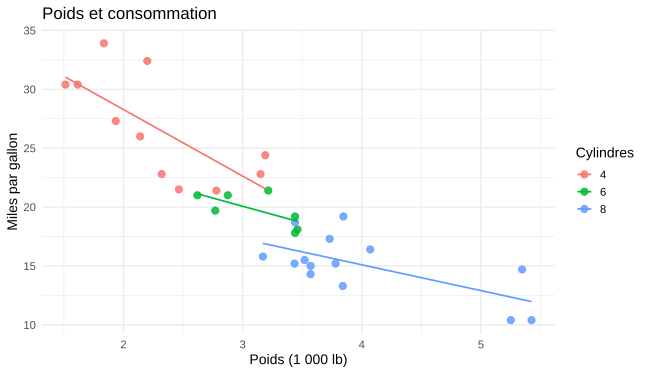{.shot .chart-shot}

<small>`ggsave("figure.svg", device = svglite::svglite)`</small>
:::
::: {.visual}
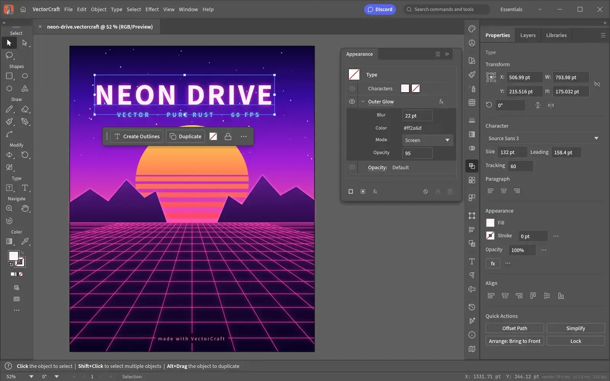{.shot .editor-shot}

<small>[Capture : VectorCraft](https://getartcraft.com/apps/vectorcraft)</small>
:::
:::

<div class="links">
<a href="https://svglite.r-lib.org/" target="_blank">svglite</a>
<a href="https://inkscape.org/" target="_blank">Inkscape</a>
<a href="https://wiki.inkscape.org/wiki/TutorialsAndHelp" target="_blank">Tutoriels Inkscape</a>
<a href="https://getartcraft.com/apps/vectorcraft" target="_blank">ArtCraft VectorCraft</a>
</div>

## Copilot Student et OpenCode {nav-title="PETITES TÂCHES"}

::: {.copy-wide}
**Copilot Student :** complétion et petites modifications dans l'éditeur, si le compte est éligible à GitHub Education.

**OpenCode + Nemotron :** autre assistant pour des tâches courtes ; vérifier le modèle, le fournisseur et ses conditions d'accès.
:::

::: {.two-visuals}
::: {.visual}
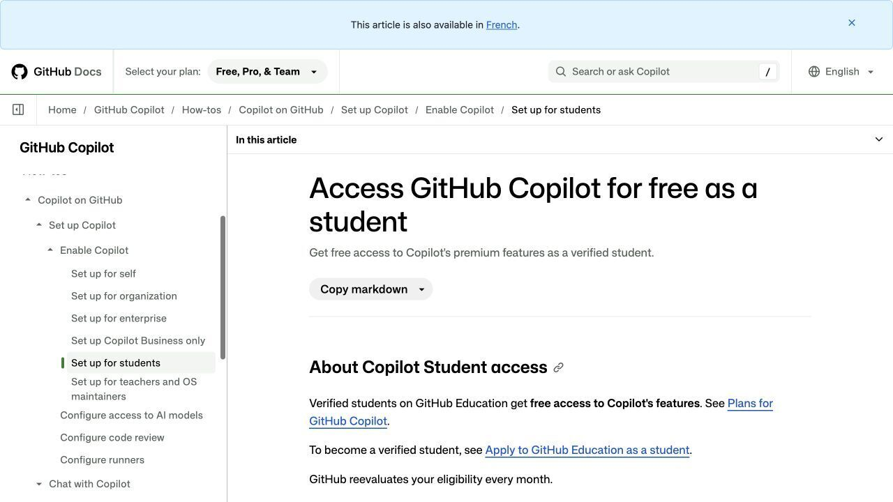{.shot .small-shot}
<small>[Activer Copilot Student](https://docs.github.com/en/copilot/how-tos/copilot-on-github/set-up-copilot/enable-copilot/set-up-for-students)</small>
:::
::: {.visual}
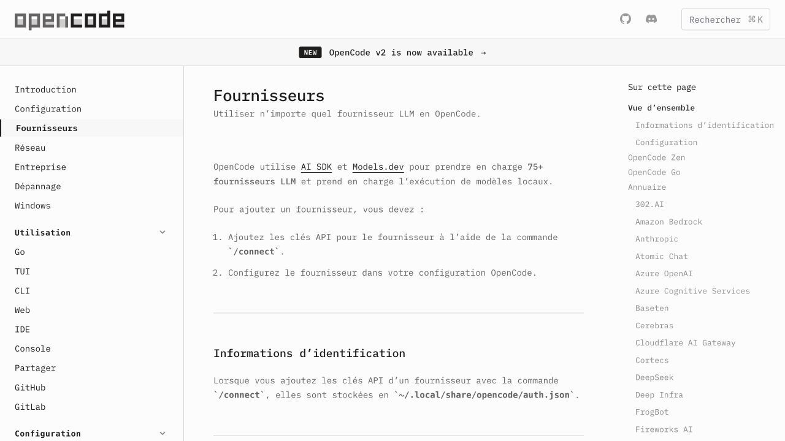{.shot .small-shot}
<small>[Fournisseurs OpenCode](https://opencode.ai/docs/providers/)</small>
:::
:::

## GitHub : versions et HTML public {nav-title="GITHUB"}

::: {.layout}
::: {.copy}
```bash
git status
git diff
git add analyse.qmd scripts/
git commit -m "Met à jour les analyses"
git push
```

Pour un rapport public : rendu HTML dans `docs/`, puis GitHub Pages. Vérifier les fichiers publiés avant le `push`.

<div class="links">
<a href="https://docs.github.com/en/get-started/learning-to-code/getting-started-with-git" target="_blank">Tutoriel Git</a>
<a href="https://quarto.org/docs/publishing/github-pages.html" target="_blank">Quarto → GitHub Pages</a>
<a href="https://thomashusson29.github.io/These_Brieuc/" target="_blank">Exemple publié</a>
</div>
:::
::: {.visual}
{.shot}

<small>[Capture : site These_Brieuc](https://thomashusson29.github.io/These_Brieuc/)</small>
:::
:::

## Grist LaSuite : tables liées {nav-title="GRIST"}

::: {.layout}
::: {.copy}
**Exemple :** `Patients` → `Épisodes` → `Mesures`.

Créer les références entre tables, définir les droits, puis exporter les données pour l'analyse R.

Pour des données de santé, vérifier l'instance et l'autorisation de l'établissement avant utilisation.

<div class="links">
<a href="https://lasuite.numerique.gouv.fr/services/grist" target="_blank">Grist LaSuite</a>
<a href="https://support.getgrist.com/fr/col-refs/" target="_blank">Références entre tables</a>
<a href="https://support.getgrist.com/fr/exports/" target="_blank">Exporter</a>
</div>
:::
::: {.visual}
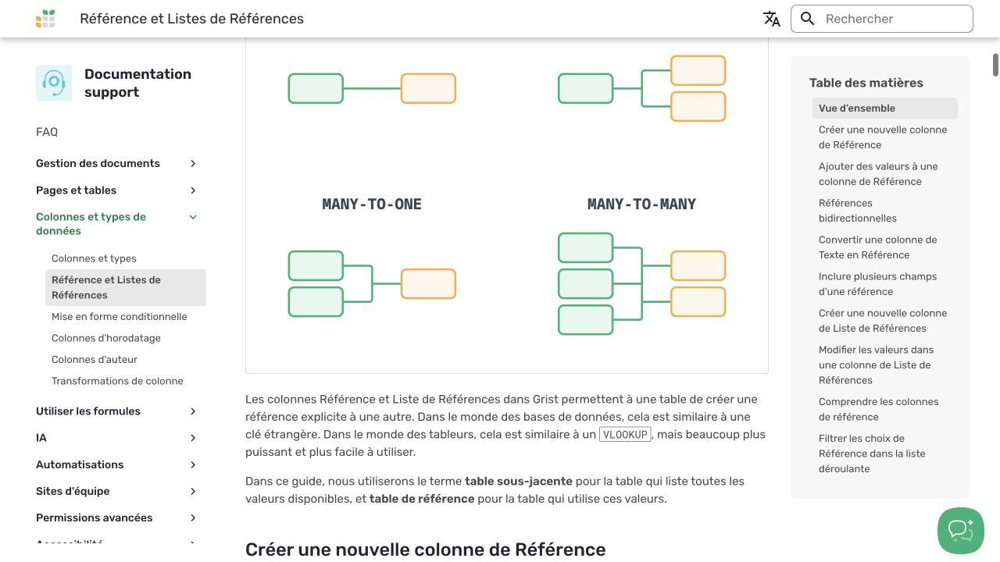{.shot}

<small>[Capture : documentation Grist](https://support.getgrist.com/fr/col-refs/)</small>
:::
:::

## Vercel : application avec serveur {nav-title="VERCEL"}

::: {.layout}
::: {.copy}
Pour un formulaire, une API, un compte utilisateur ou un calcul lancé à la demande.

L'application demande alors de gérer le serveur, les accès, les données et le déploiement. Le rapport HTML statique peut rester sur GitHub Pages.

<div class="links">
<a href="https://vercel.com/docs/functions" target="_blank">Fonctions Vercel</a>
<a href="https://vercel.com/docs/plans/hobby" target="_blank">Plan Hobby</a>
</div>
:::
::: {.visual}
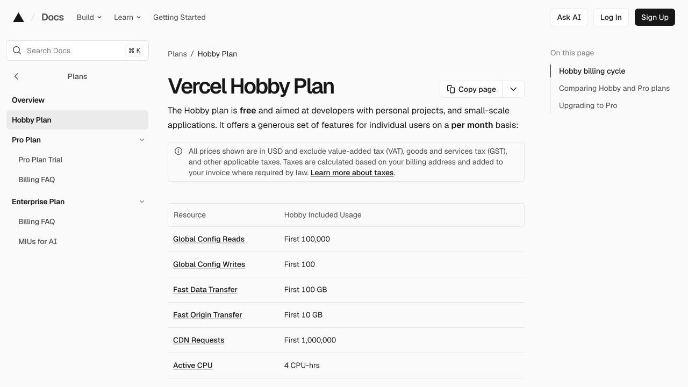{.shot}

<small>[Capture : documentation Vercel](https://vercel.com/docs/plans/hobby)</small>
:::
:::
